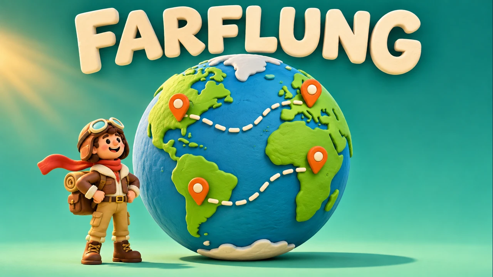
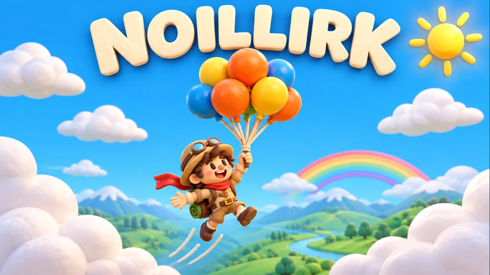
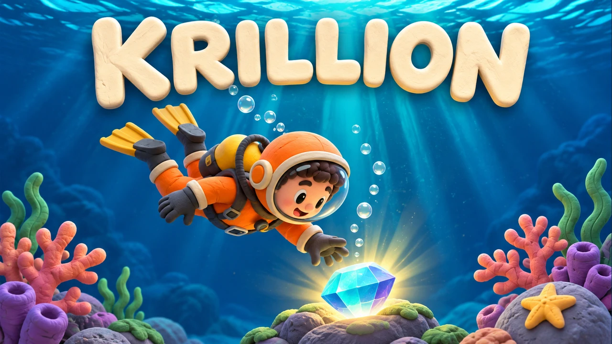

# Farflung Noillirk

**Explore the map, think like the crowd, or find the unexpected.**

Website: [farflungnoillirk.com](https://farflungnoillirk.com/)

## Farflung — explore the map

Read geography clues and choose countries on a world map. The independent Globe Crowd edition offers Popular and Rare modes, with five clues per flight.

[Explore Farflung](https://farflungnoillirk.com/games/Farflung/)

## Noillirk — think like the crowd

Look for a familiar answer that fits the prompt. The independent Popular Answers edition uses a balloon-climbing theme and simulated scoring weights in its preview question bank.

[Explore Noillirk](https://farflungnoillirk.com/games/Noillirk/)

## Krillion — go beyond the obvious

Find a valid answer others might overlook. The independent Rare Dive edition offers Daily and Practice with its own prompts and editorial scoring.

[Explore Krillion](https://farflungnoillirk.com/games/Krillion/)

## Find your kind of clever

- Search by game name or a familiar term such as map, popular or rare.
- Compare the three play styles and follow illustrated instructions.
- Keep favorites and recently opened game pages in your current browser.
- Open games in their own tab when you need more room.

[How to Play](https://farflungnoillirk.com/how-to-play/) · [Scoring Explained](https://farflungnoillirk.com/scoring/)

## About these editions

This is an independent hub. The embedded editions are separate from the original Farflung, Noillirk and Krillion services: questions, accounts and scores are not shared. Preview scores are not verified live player surveys. Illustrations show each game's theme, not captured gameplay.

Hub accounts and cloud synchronization are not open. Favorites and recently opened pages stay on this device; they are not game saves. External games require an internet connection and remain subject to their own availability.

[About Us](https://farflungnoillirk.com/about/) · [Contact](https://farflungnoillirk.com/contact/) · [Privacy Policy](https://farflungnoillirk.com/privacy/) · [Terms of Service](https://farflungnoillirk.com/terms/)

Questions or corrections: [mooyuking@gmail.com](mailto:mooyuking@gmail.com)
